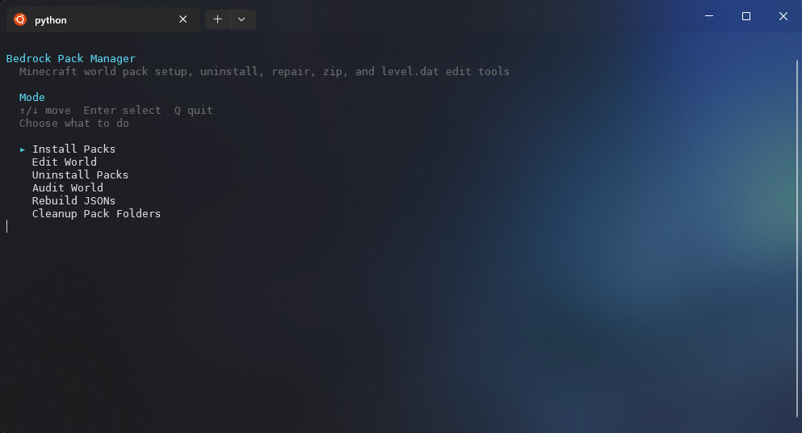

# Bedrock Pack Manager

## 100% Vibe Coded - Make backups!

Install Minecraft Bedrock behavior packs and resource packs into a world from `.mcaddon`, `.mcpack`, `.zip`, or already-extracted folders.
All runtime data lives under `run/` so the project root stays clean.

## Use It In Your Browser

The easiest way to use Bedrock Pack Manager is the hosted web app, with nothing to download or install:

**https://xigbclutchix.github.io/bedrock_pack_manager/**

1. Open the page in Chrome or Edge and click **Choose folder**, then pick your server folder (the one with `worlds`, `behavior_packs`, and `resource_packs`).
2. Pick a world.
3. Drop in `.mcaddon` or `.mcpack` files and click **Install packs**. Changes are saved straight into the folder.

In other browsers (Firefox, Safari, phones), zip the folder, click **Upload a .zip of it instead**, and use **Download updated folder** when you're done.

The page also covers world edits (Beta APIs, gamemode), uninstall, audit, rebuild, cleanup, and downloading a zip for your server host.
It runs the same Python code as the CLI inside the browser using [Pyodide](https://pyodide.org), so your files never leave your computer.

## Interactive Menu

The default interactive mode opens a keyboard-driven menu for install, uninstall, rebuild, audit, cleanup, and world-edit flows.



## Setup

```bash
python3 -m venv .venv
. .venv/bin/activate
pip install -r requirements.txt
```

Use the local `.venv` for normal development, testing, linting, and builds instead of installing tools into the system Python environment.
`requirements.txt` includes the runtime dependency plus the project's current test and lint tooling.

## Project Commands

Activate the virtual environment first:

```bash
. .venv/bin/activate
```

```bash
make run
make test
make test-verbose
make lint
make lint-fix
make site
make serve-site
make install-hooks
make clean
```

## Local Git Hooks

For practical local enforcement on every change:

```bash
make install-hooks
```

On Windows PowerShell:

```powershell
powershell -ExecutionPolicy Bypass -File .\scripts\install_git_hooks.ps1
```

That configures Git to use the tracked hooks in `.githooks/`:

- `pre-commit`: runs `python -m ruff check .` from the local `.venv`
- `pre-push`: runs `python -m pytest` from the local `.venv`

The hooks work with either `.venv/bin/python` or `.venv\Scripts\python.exe`.

## GitHub Actions

This repo includes two GitHub Actions workflows:

- `.github/workflows/quality-checks.yml`
  - installs dependencies from `requirements.txt`
  - runs `ruff check .`
  - runs `pytest`
- `.github/workflows/deploy-site.yml`
  - builds the browser app with `scripts/build_site.py`
  - deploys `dist/site/` to GitHub Pages on every push to `main`
  - requires **Settings → Pages → Source: GitHub Actions** to be enabled once

## Testing

```bash
pytest
```

Coverage is enabled by default through pytest configuration. Running `pytest` will print a terminal coverage report and write `coverage.xml`.

## Linting

```bash
make lint
make lint-fix
```

`make lint` runs Ruff across the project using the configuration in `pyproject.toml`.
`make lint-fix` applies Ruff's automatic fixes where possible.
The current Ruff line length is `180`.

## Web App

The browser app lives in `web/` (`index.html`, `app.js`, `style.css`).
`bedrock_pack_manager/web.py` is the small bridge the page calls; everything else is the same package the CLI uses.

Build and preview it locally:

```bash
. .venv/bin/activate
make serve-site
```

Then open `http://localhost:8000`. `make site` only builds `dist/site/` without serving it.
The page loads Pyodide from jsDelivr and `nbtlib` from PyPI, so it needs an internet connection the first time.

## Usage

```bash
python bedrock_pack_manager.py --help
python bedrock_pack_manager.py
python bedrock_pack_manager.py --uninstall
python bedrock_pack_manager.py --uninstall --uninstall-keep-files
python bedrock_pack_manager.py --rebuild
python bedrock_pack_manager.py --cleanup-pack-folders
python bedrock_pack_manager.py --zip
python bedrock_pack_manager.py --zip-name world.zip
python bedrock_pack_manager.py --beta
python bedrock_pack_manager.py --gamemode creative
python bedrock_pack_manager.py --beta --gamemode creative
python bedrock_pack_manager.py --doctor
python bedrock_pack_manager.py --doctor --world-name "My World"
python bedrock_pack_manager.py --rebuild --world-path "My World"
python bedrock_pack_manager.py --duplicate-mode replace
python bedrock_pack_manager.py --rebuild --beta
python bedrock_pack_manager.py --rebuild --beta --zip
```

`--zip-name` implies `--zip`, so `python bedrock_pack_manager.py --zip-name world.zip` is valid on its own.

When launched without flags in an interactive terminal, the app shows a keyboard-driven menu flow:

- first choose install, edit world, uninstall, audit, rebuild, or cleanup from the menu
- if you choose install, it asks for a zip output name
- leave the zip name blank to skip zipping
- enter a name like `world.zip` to run zip mode with that filename
- if you choose uninstall packs, a second menu lets you toggle one or more registered behavior/resource packs to remove from that world
- uninstall mode warns before removing now-unused pack folders from disk and lets you keep files with JSON-only removal instead
- rebuild and cleanup menu entries include warnings because rebuild overwrites world pack JSONs and cleanup deletes unregistered pack folders
- if you choose edit world, a second menu lets you toggle one or more world edits, then submit them together
- world edit prompts warn that selected changes are written directly to `level.dat`
- if `Set Gamemode` is selected, a final menu asks which gamemode to write to `level.dat`
- use `Up` and `Down` to move
- press `Space` to toggle options in multi-select menus
- press `Enter` to continue
- press `Q` or `Ctrl+C` to quit
- leave all install options unchecked to continue with normal install mode

When stdin/stdout is not a fully interactive terminal, the app falls back to plain prompt-based input instead of the arrow-key menu UI.

The interactive menus work in POSIX terminals and on modern Windows consoles such as Windows Terminal and PowerShell.

When the app finishes in an interactive terminal, it waits for `Enter` before closing.
On startup, the app creates the full runtime folder tree under `run/` before logging, world selection, install, or uninstall logic runs.

Install mode can also control how duplicate pack UUIDs are handled:

- `--duplicate-mode replace`: replace existing installed copies for that UUID and update the world entry
- `--duplicate-mode skip`: keep the currently installed UUID/version and skip the incoming pack
- `--duplicate-mode keep-both`: keep older copies on disk, install the new one beside them, and update the world entry to the new version

World edit mode can also be driven directly from the CLI:

- `--beta` enables Beta APIs in the selected world's `level.dat`
- `--gamemode survival|creative|adventure` sets the world's default gamemode in `level.dat`
- `--beta --gamemode creative` applies both world edits in one run

Uninstall mode can also be driven directly from the CLI:

- `--uninstall` opens a pack picker for the selected world
- uninstall always removes the pack from the selected world's JSON
- `--uninstall-keep-files` removes the JSON registration but leaves installed pack folders on disk
- installed pack folders are only deleted when no other world still references that same pack version
- if `run/uninstall/` contains pack files or folders, uninstall mode uses those manifests as the removal list instead of opening the picker
- processed uninstall inputs are moved to `run/uninstalled/`

Cleanup mode can also be driven directly from the CLI:

- `--cleanup-pack-folders` scans installed pack folders in `run/behavior_packs/` and `run/resource_packs/`
- each folder's `manifest.json` UUID and version is compared against the selected world's JSON registrations
- folders not registered in that world are deleted
- folders are kept when another world still references that same pack version

`--duplicate-mode` applies to install mode only. It does not affect `--doctor`, `--uninstall`, `--rebuild`, `--cleanup-pack-folders`, `--beta`, `--gamemode`, or `--zip` when those are run on their own.

World selection can also be driven directly from the CLI:

- `--world-name "My World"` selects `run/worlds/My World`
- `--world-path "My World"` resolves a relative path from `run/worlds/`
- `--world-path /absolute/path/to/World` uses an absolute path directly
- if neither flag is provided, the existing interactive or prompt-based world picker is used
- `--world-name` and `--world-path` are mutually exclusive

## What It Does

- Extracts archive files, including nested `.mcpack` files inside `.mcaddon` archives
- Detects whether a pack is a behavior pack or resource pack from `manifest.json`
- Accepts `manifest.json` files that include `//` or `/* ... */` comments
- Copies packs into `run/behavior_packs/` or `run/resource_packs/`
- Registers packs in the selected world's JSON files
- Rebuilds world pack JSON files from installed pack folders on demand
- Cleans up installed pack folders that are no longer registered to the selected world
- Audits installed packs and world registrations without modifying files, listing detected packs in the terminal
- Warns about missing dependencies, invalid files, and old manifest versions
- Moves processed input from `run/install/` to `run/installed/`
- Writes a plain-text execution log to `run/logs/latest.txt` and keeps the 5 most recent timestamped logs

## Folder Structure

- `run/install/`: drop `.mcaddon`, `.mcpack`, `.zip`, or extracted pack folders here
- `run/installed/`: processed files and folders are moved here
- `run/uninstall/`: drop `.mcaddon`, `.mcpack`, `.zip`, or extracted pack folders here to remove matching packs from a world
- `run/uninstalled/`: processed uninstall files and folders are moved here
- `run/behavior_packs/`: installed behavior packs
- `run/resource_packs/`: installed resource packs
- `run/worlds/`: world folders containing `level.dat` and pack JSON files
- `run/logs/`: `latest.txt` plus the 5 most recent timestamped run logs

## Project Layout

- `bedrock_pack_manager.py`: thin CLI entrypoint
- `bedrock_pack_manager/cli.py`: startup and argument handling
- `bedrock_pack_manager/commands.py`: install, uninstall, rebuild, cleanup, zip, world edit, and audit command handlers
- `bedrock_pack_manager/install.py`: install workflow and dependency checks
- `bedrock_pack_manager/worlds.py`: world selection and world JSON helpers
- `bedrock_pack_manager/manifests.py`: manifest parsing and pack classification
- `bedrock_pack_manager/nbt.py`: `level.dat` NBT helpers for world edits
- `bedrock_pack_manager/logger.py`: run log capture and retention
- `bedrock_pack_manager/paths.py`: shared project paths
- `bedrock_pack_manager/console.py`: console output and shared app state
- `bedrock_pack_manager/terminal.py`: terminal capability and keypress helpers
- `bedrock_pack_manager/constants.py`: shared pack/archive constants
- `bedrock_pack_manager/web.py`: bridge used by the browser app
- `web/`: static browser app published to GitHub Pages
- `scripts/build_site.py`: builds the browser app into `dist/site/`

## Requirements

- Python 3.10+
- `nbtlib>=2.0.4`
- `pytest>=8.0.0` and `pytest-cov>=5.0.0` for testing
- `ruff>=0.9.0` for linting

Project dependency layout in `pyproject.toml`:

- runtime dependency: `nbtlib`
- optional `test` extras: `pytest`, `pytest-cov`, `ruff`
- optional `lint` extras: `ruff`
